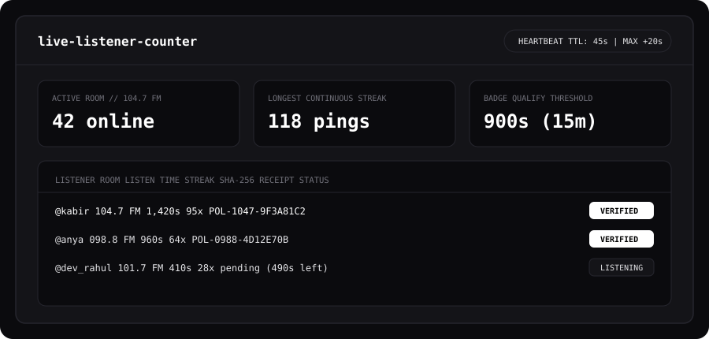

# live-listener-counter


Zero-dependency Node.js + JavaScript heartbeat attendance counter, listener streak tracker, and SHA-256 Proof-of-Listen receipt verifier for live audio rooms.

If you only count open WebSocket connections for live audio rooms, zombie mobile tabs inflate your room numbers and fake single-POST timers cheat listen rewards. This library tracks real 15-second heartbeats, clamps max delta per ping so nobody can spoof 3 hours in one request, evicts silent tabs after `45s`, and issues verifiable SHA-256 session receipts once a listener hits the target airtime.



## What this thing actually does

- **Bounded heartbeat attendance (`ListenerAttendanceTracker`)**: Clamps per-ping time accrual (`maxDeltaSeconds = 20`), tracks continuous `heartbeatStreak` + `longestStreak`, and drops stale listeners automatically when `now - lastHeartbeatAt > ttlMs`.
- **Dial-aware station registry (`channelRegistry.js`)**: Maps FM-style audio room channels (`107.9` down to `092.1`) and locates the nearest live station on the dial (`findNearestActiveChannel`).
- **SHA-256 session attendance receipts (`proofOfListenService.js`)**: Generates deterministic Web Crypto / Node `crypto` SHA-256 receipts (or accepts a custom Ed25519 message signer) with automatic per-session deduplication.
- **Zero-dependency HTTP server included**: Run `npm start` to expose `/heartbeat`, `/rooms/:id/listeners`, `/stations/:frequency`, and `/badges/claim` out of the box.

## Run it in 60 seconds

```bash
git clone https://github.com/LevCodeLab/live-listener-counter.git
cd live-listener-counter

# Zero npm packages needed! Run unit + HTTP integration tests immediately:
npm test

# Start the standalone HTTP heartbeat server on :3020
npm start
```

Test a heartbeat from another terminal:

```bash
curl -X POST http://localhost:3020/heartbeat \
  -H "Content-Type: application/json" \
  -d '{"roomId":"104.7","listenerId":"user_01","handle":"kabir"}'
```

## Where to edit stuff

| File | What lives here |
| :--- | :--- |
| `src/services/attendanceTracker.js` | `ListenerAttendanceTracker` class: TTL eviction, anti-cheat delta clamp, and streak math |
| `src/services/proofOfListenService.js` | SHA-256 attendance badge issuer, integrity verifier, and storage adapter |
| `src/data/channelRegistry.js` | Station dial definitions plus `findNearestActiveChannel` and `findMostRecentActiveChannel` |
| `src/services/fmService.js` | Station metadata lookup with optional `FM_API_URL` remote fetch |
| `src/server.js` | Zero-dependency Node `http` server exposing heartbeat and badge claim routes |
| `test/listenerCounter.test.js` | Unit and HTTP endpoint test suite (`node:test`) |

## License

MIT License. Clone it, break it, ship it.
